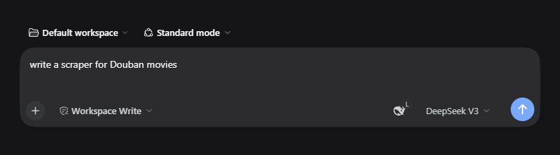
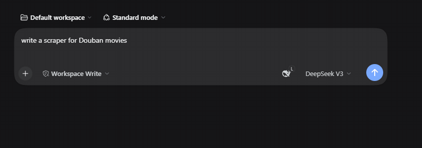
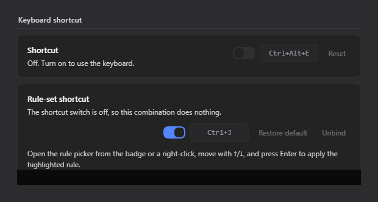
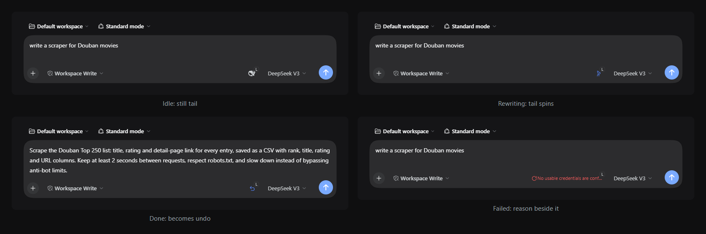
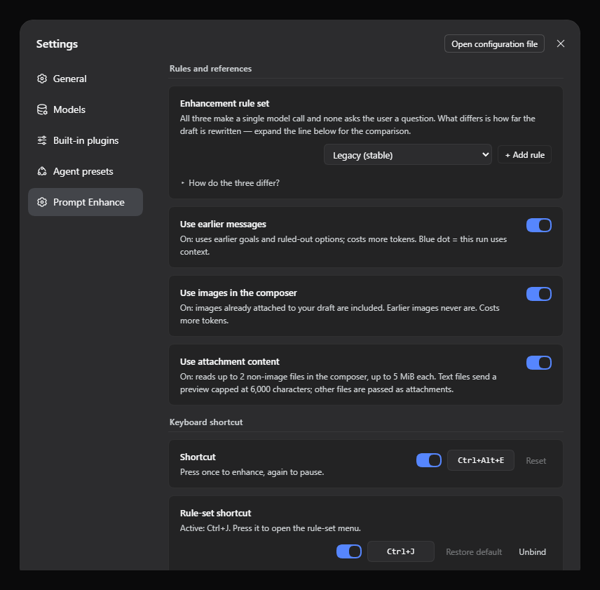

# dsh-prompt-rewriter

English | [中文](README.md)

[](https://www.npmjs.com/package/dsh-prompt-rewriter)
[](LICENSE)
[](https://github.com/deepseek-ai)
[](https://dsh-plugin.org/plugins/huaguoxingkong/dsh-prompt-rewriter)

Turn the half-formed sentence in your composer into a task brief you can actually run — **in place**. It rewrites the text only: it never sends and never runs anything. Not happy? `Ctrl+Z` puts your draft back.

<p align="center">
  
  <br>
  <sub>Figure 1: click the whale tail and the draft becomes a complete prompt</sub>
</p>

- **One-click, in place**: the whale-tail button at the right of the composer fills in the goal, the format and the boundaries, then puts the result back in the composer.
- **Three ways into the rule menu**: the button badge, a right-click on the button, or `Ctrl+J` — all open the same switcher.
- **Undoable, with controls for context**: the button turns into an undo arrow when done; conversation, images and attachments each have their own switch.

```sh
dsh plugin --profile desktop add dsh-prompt-rewriter
```

---

## What it is

A one-line draft is missing the **goal, the format and the boundaries**. The model has to guess — and a wrong guess costs you another round. The button adds those three to the sentence you already wrote:

| What it adds | Your draft | What goes back in the composer |
|---|---|---|
| Your words | *write a scraper for Douban movies* | the same sentence |
| The goal | | movie **names, ratings and links** for the **Top 250** |
| The format | | write the result to a **CSV file** |
| The boundaries | | respect robots.txt, **at least 2 seconds between requests**, **slow down instead of bypassing** anti-bot limits |

The third column is not yours — it is what the button inferred from that sentence. And it is yours to edit: it lands in the composer, nowhere else.

One job, with the surroundings done properly:

- **Three ways to switch rule sets**: badge, right-click, `Ctrl+J` — one menu, it switches and never edits.
- **Editable shortcuts**: both the enhance key and the rule-set key can be recorded, reset to default, or unbound; the rule-set key has its own switch.
- **Undoable**: the button becomes an undo arrow, and `Ctrl+Z` also restores your own draft.
- **Context, images and attachments controlled separately**: each has its own switch in settings.

Two notes: the result **never contains a counter-question** (if the model slips one in, the question is dropped and the rewrite kept; if the whole output is a question, it re-runs with the legacy rules and otherwise keeps your draft); and **the rule set is switchable** (legacy / intent-first / WorkBuddy) without changing the button or the steps.

---

## Install

Requires DeepSeek Harness (desktop or web) and `node >= 22`. **Restart Harness once after the first install**: the host half (the enhance endpoint and the prompt rules) is loaded at startup. After that, updates that only touch `client.js` show up on a page refresh (client HMR replaces the open window within about a second); changes to `index.js` or the rule files still need a restart — the install script in this repo prints whether a restart is needed.

**From npm (recommended)**

```sh
dsh plugin --profile web add dsh-prompt-rewriter      # web
dsh plugin --profile desktop add dsh-prompt-rewriter  # desktop
```

Use the profile you actually run; the plugin is a web-platform front-end plugin, so both work.

**From source**

```sh
dsh plugin --profile web add github:huaguoxingkong/dsh-prompt-rewriter
```

A source install runs the build step and may ask you to authorise it the first time. Only give that to packages you trust.

**From the Release zip**

Download a zip from [Releases](https://github.com/huaguoxingkong/dsh-prompt-rewriter/releases), unzip, then `npm install && dsh plugin --profile web add .`.

---

## Usage

1. Write a draft in the composer — however short.
2. Click the **whale-tail icon** in the row of controls at the right of the composer (a blue dot at its lower-right means it will use context). It shares that control strip with the model picker and the send button, and is hidden while the composer is empty.
3. A moment later the draft is replaced by the rewritten prompt. How long depends on the model you are on.
4. Not happy? `Ctrl+Z`, or click the undo arrow the button has become.

Click it again to give up mid-run: the task is cancelled, the draft stays as it was, and nothing half-written is left behind.

**Want it faster**: an enhance is a real model call, so the speed mostly depends on the model in use. On the same draft, a faster model can be the difference between a few seconds and a dozen. The button is model-agnostic — it uses whichever you picked. To pin one model for enhancement without affecting normal chat, open `Settings → Prompt Enhance` and turn on “Model used for rewriting”.

**You can navigate away while it runs**: you do not have to watch it. Switch to another session and the task keeps going; come back and the result is already in the composer. Two sessions can each run one at the same time.

**When the composer has attachments or links**: they count as “what you already said”. The rewrite only touches the sentence beside them — attachment chips and link chips stay in place, and an undo only restores the words you typed.

---

## Shortcuts

Two keys, two jobs: the enhance key triggers a rewrite, the rule-set key opens the switcher. Both are editable and both can be switched off on their own.

**Enhance shortcut (off by default)**: open it under `Settings → Prompt Enhance → Shortcuts`. `Ctrl+E` on desktop (`Cmd+E` on macOS), `Ctrl+Alt+E` in the browser (`Cmd+Alt+E`). Press once to enhance, press again while it runs to pause; it acts on the composer of the current session. It goes through the icon's own click entry, including the undo state — there is no second code path. Click the current combo to record a new one, `Esc` cancels, **Restore default** puts it back. A combination already taken by another command is refused with the name of that command, the old binding stays.

**Rule-set shortcut (`Ctrl+J` by default, on by default)**: press it to open the rule picker; `↑` / `↓` move the highlight, `Enter` applies, `Esc` closes without changing.

<p align="center">
  
  <br>
  <sub>Figure 2: Ctrl+J opens the rule picker; ↑↓ moves, Enter applies</sub>
</p>

- **It works on an empty composer**: the menu opens against the composer and stays on screen when the window narrows; the highlight and the radio dot both point at the rule set in effect, not at the first row.
- The rule-set row in the Shortcuts group can record or type a combination, and supports **Restore default** and **Unbind**.
- The rule-set key has **its own switch**: turning it off keeps the combination and turning it back on restores it; with the master shortcut switch off, neither key works.
- Combinations are validated before saving: browser or system reserved keys (e.g. `Ctrl+T`) are refused, and keys already taken by the host (e.g. `Ctrl+Alt+K` belongs to “Search sessions”) are refused by name. Neither is written to disk.

**Rule-set badge**: it sits at the upper-right of the enhance button and shows the rule set in effect.

<p align="center">
  
  <br>
  <sub>Figure 3: the five badge states — L, I, WB, EN, Off</sub>
</p>

- The three built-ins show **L / I / WB** in the English UI (旧 / 意 / WB in Chinese).
- A custom rule is abbreviated from its name: one character for Chinese, the first two for English or digits (`English` → `EN`, `123` → `12`).
- When the selected rule is unavailable (disabled or deleted) the badge shows `Off` (关 in Chinese).

**Shortcut settings**: the Shortcuts group keeps both keys together — each row has a switch, the current combination and Restore default (the rule-set row also has Unbind), plus a usage hint under the rule-set row.

<p align="center">
  
  <br>
  <sub>Figure 4: the Shortcuts group — a switch, a combination and Restore default per key</sub>
</p>

---

## Button states

<p align="center">
  
  <br>
  <sub>Figure 5: the four button states — idle, rewriting, done with undo, failed with retry</sub>
</p>

| State | What you see | What it means |
|---|---|---|
| Idle | a still whale tail | ready to click |
| Rewriting | the tail spins fast | running; click again to cancel |
| Done | it becomes an undo arrow | one click restores, or `Ctrl+Z` |
| Failed | a red retry icon + the reason | the reason is beside the button, no log hunting |

---

## Settings

<p align="center">
  
  <br>
  <sub>Figure 6: the settings page — rules, references and shortcuts</sub>
</p>

`Settings → Prompt Enhance`. Six switches, two pickers (model, rule set), and a “custom rules” entry in the rule-set picker — **this only affects the button, never normal sending**.

| Option | Default | What turning it on does |
|---|---|---|
| Model used for rewriting | off | off: follow the model of the current conversation. on: pin the model chosen in the picker. |
| Enhancement rule set | **legacy (stable)** | three choices: legacy / intent-first / WorkBuddy, see below. |
| Reference earlier conversation | **on** | reads what was said before. More accurate, more tokens, slower on long chats. |
| Reference images in the composer | off | images in the composer take part. Images in earlier messages are never read. |
| Reference attachment content | **on** | on: reads up to 2 non-image attachments from the composer, each up to 5 MiB; text files contribute at most a 6000-character preview. off: only up to 8 file names become context. |
| Enhance shortcut | off | enables the keyboard trigger. Off by default so it never takes a key you did not ask for. |
| Rule-set shortcut | **on** | `Ctrl+J` switches the rule set; turning it off keeps the combination and turning it back on restores it. |

**How the three rule sets differ**

- **legacy (stable)**: the rule text shipped in 1.7.1, verbatim (15 lines, 10 rules), roughly 1.2–3× the original.
- **intent-first**: infers what you are really asking for, then completes it across six dimensions (goal / input / scope / method / output / quality bar); where the draft is silent the executor must decide and declare its assumptions. Sparse drafts usually grow 2–5×, capped at 5×.
- **WorkBuddy**: the original prompt shipped with it, verbatim (analyse goal, ambiguity, clarity and missing context, then rewrite under seven principles); capped near 800 characters, so long drafts are compressed.
- None of them answer the request itself; legacy and intent-first explicitly forbid counter-questions, WorkBuddy only forbids answering the request, so a question it returns is dropped by the plugin.

**Other behaviour**

- The model picker lists the providers and models you **actually have**; you cannot enter one that does not exist, and switching the option off does not clear your choice.
- Images that are still uploading, or that exceed the attachment service's limits, are skipped; the status area says how many were left out, so one bad image never fails the whole rewrite.
- The top-right of the settings page shows the **current version**; click it to open the project page. The changelog at the bottom is folded per version and comes from the bundled `CHANGELOG.md` — it works offline.

**Custom rules**: pick a rule you named in the rule-set picker to use it. “＋ Add rule” gives you two fields — the upper one is a **meta-prompt** (copy it with one click; if the clipboard is unavailable it selects the text and asks for `Ctrl+C`). Send it to your own AI and it writes an enhancement rule set for your own habits; paste the body it produces into the lower field, name it and save. Up to 10 rules, 4000 characters each, each one can be **disabled/enabled**; **disabling or deleting the one in use** moves the selection back to “legacy” in the same save, so no dangling selection is left behind.

### What it reads and does not read

<p align="center">
  
  <br>
  <sub>Figure 7: an empty session reads the draft only; with a conversation a blue dot appears</sub>
</p>

- **Conversation**: a blue dot at the button's lower-right means it will read what was said before; without it, only the current draft. The dot describes **what a click would do right now**, so it hides while running, comes back after a failure, and disappears while the button is an undo arrow.
- **Images**: only images **in the composer**, never those in earlier messages — old screenshots are slow and easy to misread, and that boundary is deliberate.
- **Attachments**: only non-image files **in the composer**; attachments uploaded in earlier turns are not read. At most 2 per run, 5 MiB each, at most a 6000-character preview for text; with the switch off only up to 8 file names are sent.
- What reaches the prompt is the **readable file name**, not a full path such as `@D:\...`; links keep only the domain. Your local directory layout is never copied out.

---

## Configuration

Every key under the plugin's profile entry is optional. The first eleven are managed by the settings page; the last seven are operational caps and are not exposed in the UI:

```yaml
- id: dsh-prompt-rewriter
  name: dsh-prompt-rewriter
  config:
    # managed by the settings page
    useCustomModel: false      # pin enhanceProvider/enhanceModel
    enhanceProvider: ""        # empty = follow the session model
    enhanceModel: ""
    ruleSet: legacy            # legacy / intent-first / workbuddy
    customRules: "[]"          # custom rules (JSON array text): at most 10, 4000 chars each
    referenceImages: false     # read images in the composer
    referenceFiles: true       # read attachment content in the composer
    referenceContext: true     # read the earlier conversation
    shortcutEnabled: false     # enhance shortcut (off by default)
    ruleShortcut: "Ctrl+J"     # rule-set shortcut (empty = unbound)
    ruleShortcutEnabled: true  # separate switch for the rule-set shortcut

    # operational caps (not shown in the settings page)
    maxDraftChars: 8000        # draft length cap
    maxOutputChars: 12000      # output length cap
    maxOutputTokens: 2000      # per-request output token cap
    timeoutMs: 90000           # end-to-end timeout
    historyTokenBudget: 6000   # token budget for injected history
    historyMaxMessages: 24     # how many history messages at most
    historyMessageChars: 4000  # character cap per history message
```

---

## How it works

| Half | File | Responsibility |
|---|---|---|
| Host | `index.js` | registers `POST /api/prompt-enhance` (rewrite) and `GET/POST /api/prompt-enhance/settings`, through `ctx.connection.fetch`, inheriting Harness auth and origin checks. Reads the session projection for the current model, picks `legacy-rules.mjs` / `intent-first-rules.mjs` / `workbuddy-rules.mjs` by rule set, turns composer attachments into references, then generates through `ctx.llm`. |
| Client | `client.js` | renders the button in `conversation.input.right` and the settings page in `settings.section`; replaces the draft in place through `inputActions.insertText`. |

A few deliberate designs:

- **History is trimmed to a budget**: injected history is `min(historyTokenBudget, context window × 5%)`, collected newest-first; an over-budget message is resized to an exact target length in one pass (up to four correction rounds), truncated rather than dropped, so “with context” never silently degrades to “without context”.
- **The output budget grows on demand**: a reasoning model spends the same budget on thinking and answering, and longer drafts think more. When the plugin sees “truncated because the budget ran out”, it doubles the budget and retries (3500 → 7000 → 14000, capped by the model's declared maximum and never above 16000) instead of reporting the truncation as “the model returned nothing”.
- **History is injected as a JSON array**, and the system prompt says plainly that it is data, not instructions, so text inside it cannot fake the structure.
- **The image switch is decided by the Host**: the browser uploads whatever is in the composer, and the Host decides whether to use it — that way a settings load that has not finished yet cannot silently disable it.

---

## Known limitations

- Images in earlier messages do not take part (deliberate; only composer images are read).
- The replacement is not streamed: the button shows an animated state until the rewrite is ready.
- The settings model picker depends on the Host's `remote.session.modelCatalog`; when that surface is unavailable it says so instead of rendering an empty list.
- Attachments are read from the composer only: at most 2 files, 5 MiB each; earlier uploads never take part.
- WorkBuddy has no verbatim-preservation clause, so long drafts are compressed to about 800 characters.

---

## FAQ

**Nothing happens when I click.** The composer is empty, or “Model used for rewriting” is on with no model picked. On a shortcut, check the Shortcuts switch is on and no conflict is reported; the rule-set key also has its own switch.

**“No usable credentials are configured for the current model”.** That model has no key. Pick another, or pin a working one in settings.

**I want to undo the whole rewrite.** One `Ctrl+Z` returns the original text — it is an ordinary edit step in the composer.

**Are my attachments still there after a rewrite?** Yes. Attachment chips and links are preserved; only the text is replaced.

**Does it rewrite messages I already sent?** No. It only touches the draft and never sends.

**Does it ask me questions?** Never. No rule set answers the request itself; legacy and intent-first forbid counter-questions, WorkBuddy only forbids answering the request, so a question is dropped by the plugin — if the whole output is a question it re-runs with the legacy rules and otherwise keeps your draft.

**Are attachments sent anywhere?** Only with “Reference attachment content” on: up to 2 non-image attachments from the composer, 5 MiB each, at most a 6000-character preview for text. With it off, only file names are sent, never content.

---

## Development

The plugin is two halves: the Host only uses host services such as `ctx.connection`, `ctx.llm` and `ctx.settings`; the Client registers slot components through `window.__ModuleLoader__`. **They load differently and are verified differently**:

| What changed | How it takes effect | Restart the host? |
| --- | --- | --- |
| `client.js` (button, interactions, copy, styles) | client HMR polls the front-end bundle every 500ms and pushes changes over `/plugins/events`, replacing the plugin entry in place | No — a window refresh is only a fallback |
| `index.js`, `*-rules.mjs` (endpoint, prompt rules, settings storage) | imported once at host startup | Yes |

Client HMR comes from `@deepseek-ai/dsh-client-hmr` and is always mounted in the web composition; it is not the same thing as the host-side `hmr`, which the local profile sets to `disabled: true`, so host **code** has no hot reload. Config values changed in the settings page still apply immediately (they go through the settings service, not a file watcher); hand-editing `cordis.patch.yml` is what needs a restart.

**Unit tests are not published in the npm package.** The repo has a full `tests/` tree and `scripts/gate.mjs`, but they depend on the host's private `@deepseek-ai/schemastery`, on the host's React copy and on the layout of a local profile, so a fresh clone cannot run them as-is. They stay in the repo and out of the package; run them locally before publishing.

```sh
npm run check                    # index.js / client.js syntax
npm test                         # all tests/
node scripts/gate.mjs            # rules and shape gate (run before publishing)
npm pack --dry-run               # inspect the published contents
```

---

## Contributing, security and versioning

- Sending code, reporting issues and the local verification steps are in [CONTRIBUTING.md](CONTRIBUTING.md).
- How to report a security problem privately is in [SECURITY.md](SECURITY.md).
- How versions are chosen and how pre-releases are marked is in [VERSIONING.md](VERSIONING.md).

### Thanks

Issue reports and suggestions count as contributions too; each release credits them in its [CHANGELOG.md](CHANGELOG.md) entry, while this section keeps the long-term list and earlier releases.

- [@YuvuShine](https://github.com/YuvuShine): reported #8 (the enhance button vanished when a command block was present, the result was delayed, and the command block got rewritten), with reproduction steps, the root cause and a fix — adopted in 1.8.4.
- [@moyuboy](https://github.com/moyuboy): reported #4 (a control in the same slot covered the button by about 4px), with the root cause and four possible fixes — adopted in 1.8.3.
- [@xutiannuo](https://github.com/xutiannuo): reported #2 (the OpenCode provider returned 400 MissingSessionID), with a three-line fix — adopted in 1.7.1.

---

## License

The code is MIT; see [LICENSE](LICENSE). Bundled assets fall into three groups:

| Asset | License | Inside MIT? |
|---|---|---|
| Plugin code | MIT | Yes |
| The 36-frame whale-tail outline (from `dsh-status-rotator` v0.38.0, by 01Virex) | **MIT**, verified upstream (all 36 frames compared) | Yes, with its copyright notice kept |
| The DeepSeek “big fat fish” brand mark (from `dsh-web-frontend`) | **no license found** in the source package | **No**, explicitly excluded in LICENSE |

This is an unofficial community project with no affiliation with or endorsement by DeepSeek. Full attribution and the verification record are in [NOTICE.md](NOTICE.md).

---

<p>
  <sub>Listed in:</sub>
  <a href="https://awesome-dsh-plugin.com"></a>
  <a href="https://dshpluginhub.ai/plugins/dsh-prompt-rewriter"></a>
  <a href="https://deepseekharnessplugins.com/plugins/huaguoxingkong/dsh-prompt-rewriter"></a>
</p>