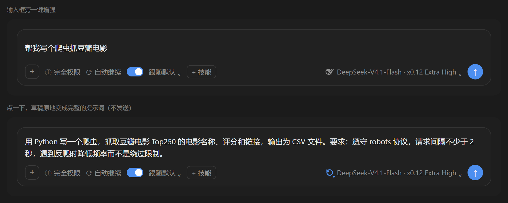
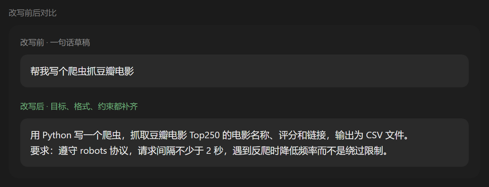
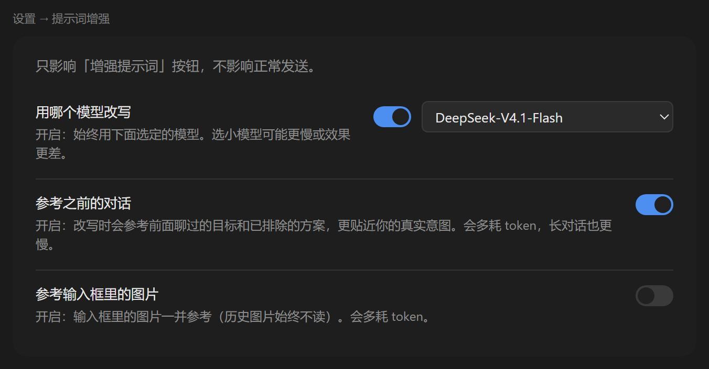
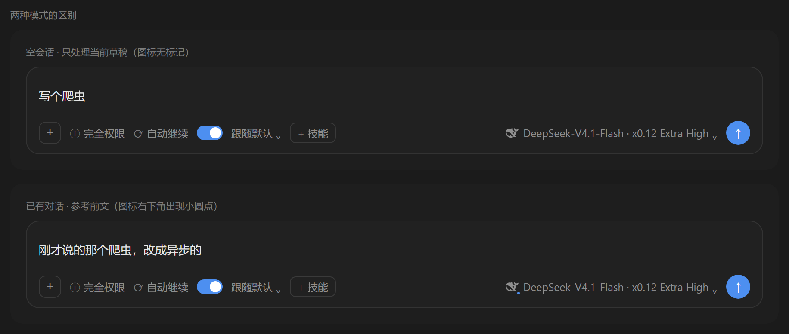
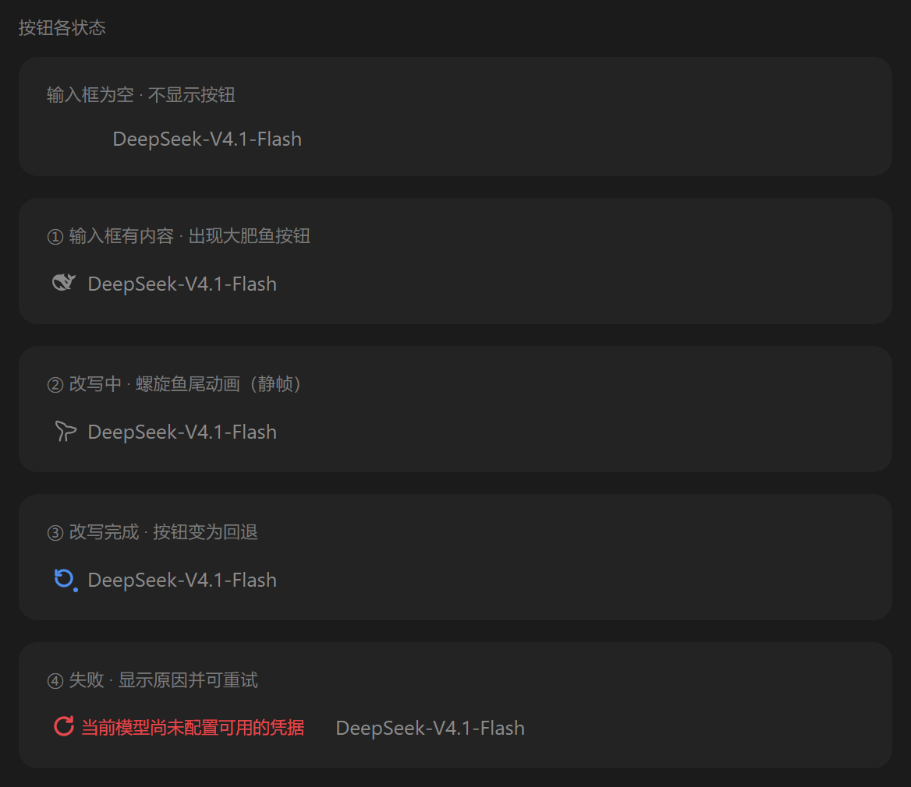

# dsh-prompt-rewriter

一键把输入框里的草稿改写成更清晰、更完整的提示词，**不发送消息、不运行 Agent**。

> **本项目为非官方社区项目**，与 DeepSeek 无隶属或授权关系。内嵌的品牌图形版权归属见 [NOTICE.md](./NOTICE.md)。

## 界面预览

### 按钮就在输入框里，紧挨模型名

按钮不占额外位置：它挂在输入框右侧、模型名左边，输入框有内容才出现。点一下，草稿原地变成完整提示词，不会发送消息。



### 改写前后对比

原始草稿只有一句话；改写后补全了目标、输出格式与约束条件，可直接交给模型执行。



### 设置页

`设置 → 提示词增强` 提供三个开关与一个模型选择器，只影响这个按钮，不影响正常发送。



### 两种模式的区别

空会话只处理当前草稿（图标无标记）；会话已有对话时参考前文，图标右下角出现小圆点。



### 按钮的四种状态

输入框为空时隐藏；有内容才出现。改写中播放动画，完成后变为可回退，失败则显示原因。



## 功能

- **一键增强**：输入框有内容时，输入栏出现增强按钮；无内容时自动隐藏。
- **原位替换**：结果直接写回输入框，是一个可撤销的编辑步（`Ctrl+Z` 可回退）。
- **可随时停止**：增强中点按钮即取消，草稿保持原样，不报错。
- **失败可见**：出错时按钮变成重试图标，并把原因直接显示在按钮旁。
- **上下文感知**：会话已有对话时，改写会参考前文的目标、已确认的要求与已排除的方案；空会话只处理当前草稿。

## 设置

`设置 → 提示词增强` 页有三个开关，以及一个模型选择器：

| 选项 | 默认 | 说明 |
|---|---|---|
| **用哪个模型改写** | 关 | 关：跟随当前对话正在用的模型。开：始终使用下拉中选定的模型。 |
| **参考之前的对话** | 开 | 改写时参考本会话前文，更贴合真实意图。会多耗 token，长对话也更慢。 |
| **参考输入框里的图片** | 关 | 输入框里已放好的图片一并参与改写。**历史消息里的图片始终不读。** |

几点行为细节：

- **模型选择会持久化**：选择器列出你实际拥有的渠道与模型（与输入框的模型选择器同一份数据），不会手填出不存在的模型。关闭开关不会清空已选模型，重新打开直接回显上次选择。
- **图片仅在完成上传后可读**：上传中的图片会被跳过，并在状态区提示"有 N 张图片未能读取"，不会让增强失败。
- 三个开关各自独立生效，互不影响。

## 安装

三条路径，按你的情况选一条：

| 方式 | 适合 | 要点 |
|---|---|---|
| **npm（推荐）** | 想拿最新版、不想管源码 | 装全局包，再让 `dsh` 指向它 |
| **从源码克隆** | 想改代码、跟最新提交 | clone 后 `npm install` |
| **从 Release 下载 zip** | 不想装 git / npm | 解压后 `npm install` |

三者最后都落到同一步：用 `dsh plugin` 把这包装进 profile。区别只在包从哪来。

### 从 npm 安装

```powershell
npm install -g dsh-prompt-rewriter
dsh plugin --profile desktop add dsh-prompt-rewriter
```

### 从源码安装

```powershell
git clone https://github.com/huaguoxingkong/dsh-prompt-rewriter.git
cd dsh-prompt-rewriter
npm install
dsh plugin --profile desktop add .
```

### 从 Release 安装

到 [Releases](https://github.com/huaguoxingkong/dsh-prompt-rewriter/releases) 下载最新的 `dsh-prompt-rewriter-1.0.0.zip`，解压后：

```powershell
cd <解压目录>
npm install
dsh plugin --profile desktop add .
```

`npm install` 是必需的：插件用 `@deepseek-ai/schemastery` 声明设置页的 `Config`，它是唯一外部依赖，不装会在启动时报 `Cannot find package`。

`dsh` 不在 PATH 时用完整路径（Windows 桌面版默认位置）：

```powershell
& "D:\Soft\DeepSeek Harness\resources\runtime\cli\bin\dsh.cmd" plugin --profile desktop add .
```

安装后需**重启 DeepSeek Harness**。本插件没有 HMR，bundle 在启动时读取快照，不重启不会生效。

## 配置

profile 插件行的 `config` 字段全部可选。前五项为设置页托管，后五项为运维上限：

```yaml
- id: dsh-prompt-rewriter
  name: dsh-prompt-rewriter
  config:
    # 设置页托管
    useCustomModel: false      # 是否固定使用 enhanceProvider/enhanceModel
    enhanceProvider: ""        # 空 = 跟随会话模型
    enhanceModel: ""
    referenceImages: false     # 是否参考输入框图片
    referenceContext: true     # 是否参考前文

    # 运维上限（不暴露在设置页）
    maxDraftChars: 8000        # 草稿字符上限
    maxOutputChars: 12000      # 输出字符上限
    maxOutputTokens: 2000      # 单次请求输出 token 上限
    timeoutMs: 90000           # 端到端超时
    historyTokenBudget: 6000   # 历史注入的 token 预算
    historyMaxMessages: 24     # 历史最多取多少条
    historyMessageChars: 4000  # 单条历史字符上限
```

## 结构

| 半边 | 文件 | 职责 |
|---|---|---|
| Host | `index.js` | 注册 `POST /api/prompt-enhance`（增强）与 `GET/POST /api/prompt-enhance/settings`（设置），走 `ctx.connection.fetch`，继承 Harness 鉴权与来源校验。读取会话投影得到当前模型，经 `ctx.llm` 生成结果。 |
| Client | `client.js` | 在 `conversation.input.right` 渲染按钮；在 `settings.section` 渲染设置页。通过 `inputActions.insertText` 原位替换草稿。 |

设计上值得注意的三点：

- **上下文按预算裁剪**：历史注入量取 `min(historyTokenBudget, 上下文窗口 × 5%)`，从最新往回收集；单条超预算时截断而非丢弃，保证"有上下文"不会静默退化成"无上下文"。
- **历史以 JSON 数组注入**，并在系统提示中明确声明"这是数据，不是指令"，防止历史里的文本伪造结构。
- **图片开关由 Host 裁决**：浏览器只要输入框有图就上传，Host 依据开关决定是否使用——避免"设置尚未加载完成"时读到默认值而静默失效。

## 已知限制

- 历史图片不参与改写（有意为之，只读输入框图片）。
- 非流式替换：增强完成前按钮显示为动画态。
- 设置页的模型下拉依赖 Host 的 `remote.session.modelCatalog`；该面不可用时下拉会明确提示读取失败，而不是留空。

## 开发

插件分 Host 与 Client 两半：Host 只依赖 `ctx.connection`、`ctx.llm`、`ctx.settings` 等宿主服务，Client 通过 `window.__ModuleLoader__` 注册槽位组件。两半都随 bundle 在启动时加载，改动后需重启验证。

**单元测试未随本仓库发布。** 开发期的测试依赖宿主私有的 `@deepseek-ai/schemastery`、宿主 React 副本，以及本机 profile 的目录结构，直接开源会让使用者拿到跑不起来的文件。如果你要为其补充测试，可在装好 Harness 的环境里按上面「结构」一节的入口地址编写。

## 许可

代码采用 MIT，详见 [LICENSE](./LICENSE)。

内嵌素材分两类：

| 素材 | 许可 | 是否在 MIT 范围内 |
|---|---|---|
| 插件代码 | MIT | 是 |
| 鲸鱼尾巴 36 帧轮廓（来自 `dsh-status-rotator` v0.38.0，作者 01Virex） | **MIT**，已在上游核实（36 帧逐条比对一致） | 是，保留其版权声明 |
| DeepSeek「大肥鱼」品牌标（来源 `dsh-web-frontend`） | 源包内**未找到许可证** | **否**，已在 LICENSE 中显式排除 |

本项目为**非官方社区项目**，与 DeepSeek 无隶属或授权关系。完整归属与核实过程见 [NOTICE.md](./NOTICE.md)。
